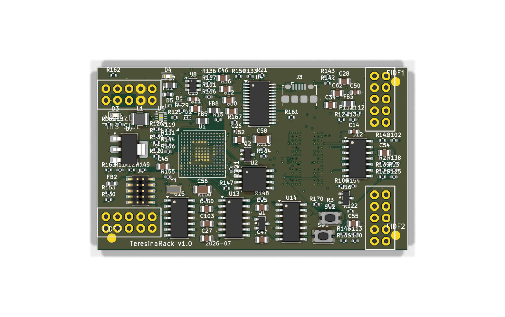
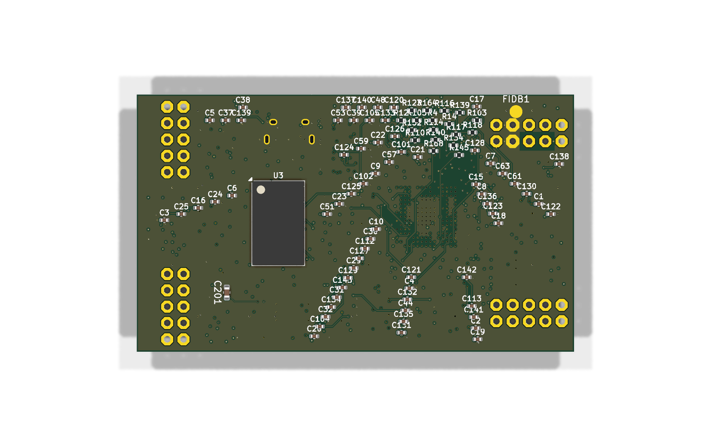
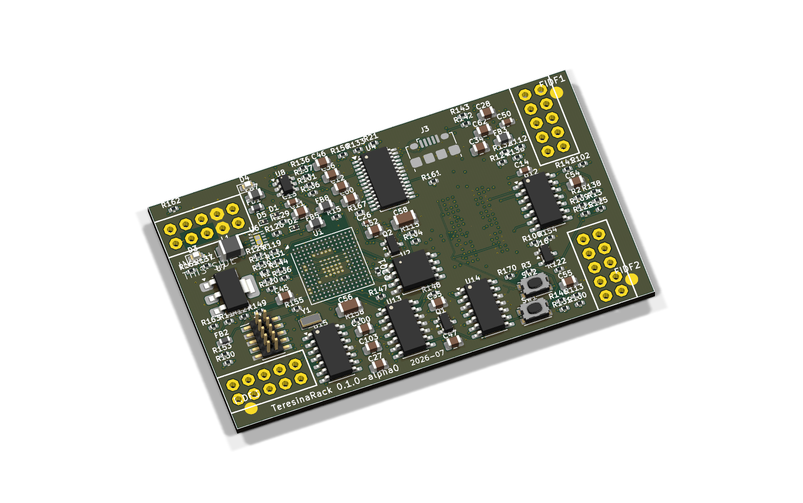

# Teresina-Rack

**Version 0.1.0-alpha0** — design-validated (DRC/ERC/SPICE/DFM clean), **not yet fabricated or
hardware-tested**. Treat everything below as pre-production until a first build is verified.

An open, self-fabricatable clone of the [Electro-Smith Daisy Patch SM](https://electro-smith.com/products/patch-sm)
— the Eurorack DSP submodule — built around the STM32H750 + 64 MB SDRAM, designed to run **stock
[libDaisy](https://github.com/electro-smith/libDaisy) `DaisyPatchSM` firmware unmodified** and to drop
into carriers such as [kivu12 / eurorack-blocks](https://github.com/ohmtech-rdi/eurorack-blocks).



| Top | Bottom |
|---|---|
|  |  |



---

## What it is

| | |
|---|---|
| Outline | **68 × 40 mm**, 1.6 mm, 12-layer, castellated 40-pad edge connector |
| MCU | STM32H750IBK6 (UFBGA-176, 480 MHz Cortex-M7) |
| RAM | AS4C16M32MSA — 64 MB SDRAM, 32-bit FMC bus |
| Flash | IS25LP064A — 8 MB QSPI |
| Codec | PCM3060 (24-bit / 96 kHz), SAI1, control on I²C2 |
| Analog | TL074 audio front-end, 3× MCP6004 CV/gate conversion, LM4040-10 V reference |
| Power | Eurorack ±12 V in → reverse protection → TPS62170 buck (+3V3) + LD1117-5.0 LDO (+5V); ferrite-isolated +3V3A (STM32 analog) and +5VA (PCM3060 analog) rails |
| I/O (via the 40 castellated pads) | 2× audio in (AC), 2× audio out (DC), 8× bipolar CV in (−5…+5 V), 4× 0–3.3 V ADC in, 2× CV out (0–5 V), 2× gate in, 2× gate out, USB (FS + HS pairs), SDMMC, SPI2, I²C1, +5 V/+3V3 out |
| On-board | micro-USB (DFU flashing), SWD header, reset + boot buttons, power/user LEDs |

## Compatibility contract (verified against official sources)

The board was validated against the **official Electro-Smith references** — the Rev3 schematic PDF,
datasheet v1.0.5, `Patch-SM_pinout.csv`, and the `DAISY_PATCH_SM.kicad_mod` footprint from
[DaisyKiCad](https://github.com/electro-smith/DaisyKiCad) — not against this project's own notes.

| Check | Result |
|---|---|
| Castellated pad positions vs official footprint | **40/40 exact** (position *and* numbering — carrier interlock guaranteed) |
| Pad functions vs official pinout CSV | **40/40** |
| STM32 ball assignments used by libDaisy firmware | **43/43** (CV_1–8, ADC_9–12, SDMMC1, SPI2, I²C1/I²C2, SAI1, USB, gates, DAC1, LED, boot) |
| Analog circuits vs official Rev3 schematic | **Component-for-component identical** (see below) |
| Codec strap/wiring vs libDaisy PCM3060 driver | I²C mode, address 0x46, correct SAI directions ✔ |

Analog blocks match the official design exactly:

- **Audio in** (each ch): 2.2 µF AC coupling → inverting buffer 66K5 / 15K ‖ 220 pF, biased at codec
  VCOM → 1K → PCM3060. (≈ −48 kHz anti-alias corner, ±5 V Eurorack level → codec level.)
- **Audio out** (each ch): PCM3060 differential → differential MFB stage 18K / 66K5 / 39K / 18 pF /
  100 pF bridge → 100 Ω, DC-coupled. SPICE-verified: flat ±0.12 dB to 20 kHz, ×2.167, −3 dB ≈ 144 kHz.
- **CV in** (×8): inverting scaler 100K signal / 200K from −10 V reference / 33K ‖ 220 pF feedback —
  maps −5…+5 V → 3.3…0 V exactly as `InitBipolarCv` expects (firmware flips polarity).
- **CV out** (×2): DAC1 → non-inverting ×1.5167 (120K/62K — the official values) → 100 Ω. 0–3.3 V → 0–5 V.
- **Gate in** (×2): 100K / 1M / MMBT3904 / 10K pull-up / 1K — 12 V-tolerant → 3.3 V logic.
- **Gate out** (×2): MCP6004 (5 V rail) level shift → 1K series.

Boot/flashing behaves like the original:

- micro-USB is on **PA11/PA12 (OTG_FS)** → the STM32 ROM DFU bootloader enumerates on it
  (`dfu-util` workflow works as on a real Patch SM). Edge pads A8/A9 carry the PB14/15 (OTG_HS) pair.
- **PG3 → BOOT_FLASH strap** (4K7 + 2.2 µF into the BOOT0 node, official values) — enables
  *software* re-boot to DFU (`System::ResetToBootloader`), important when the module is racked.
- USB VBUS back-feeds +12 V through a Schottky so the MCU can be flashed without rack power.

Corrections applied from a full evidence-based re-audit (official Rev3 schematic + component datasheets):

- **Codec analog supply (critical).** The PCM3060 requires **5 V for its analog supply** (datasheet V_CC =
  4.5–5.5 V; "5 V for analog, 3.3 V for digital"); pin 24 (V_CC) had been tied to the 3.3 V analog rail,
  which starves the codec analog section — wrong VCOM (1.65 V vs 2.5 V) and reduced/distorted audio levels.
  Fixed by adding a dedicated ferrite-filtered **+5VA** rail (FB9 off +5 V, with 100 nF + 10 µF local
  decoupling) feeding U4 pin 24 — restoring correct VCOM and full-scale audio.
- **Audio-output MFB.** 18 pF feedback caps (C120/C123) at the op-amp inverting input; 100 pF bridge caps
  (C121/C124) across the two input junctions (N_OLA/N_OLB, N_ORA/N_ORB) — the canonical differential-MFB
  topology, restoring codec-to-single-ended CMRR and phase margin.
- **Gate-in.** Now component-for-component identical to the official — base pull-down 1 MΩ, collector
  pull-up 10 kΩ, and the 1 kΩ collector series resistor (R202/R203, into PG13/PG14) fitted.
- **Voltage reference.** U16 sourcing corrected to a genuine 10 V LM4040 (LM4040C10IDBZR / C201738) — the
  BOM had carried a 3.0 V part number against the 10 V value, which would have broken CV in/out scaling.

Remaining (accepted, benign) deviations from the original: gate-out uses an MCP6004 as a comparator
(VTH 1.65 V) + 1 kΩ series instead of the official linear amp + 100 R — an equally-valid, arguably cleaner
digital-gate output; and the PA9 VBUS-sense divider is omitted (libDaisy does not enable VBUS sensing; pin
unconnected is within abs-max).

## Design choices

**12 layers with two fully solid power planes.** The dual-BGA density (STM32 + SDRAM, 0.65 mm pitch,
via-in-pad fanout) cannot be routed on 8 layers *and* keep unbroken planes. Rather than fragment the
ground plane (bad for an audio module), the board uses:

| Layer | Role |
|---|---|
| F.Cu | components, escapes, GND pour |
| **In1** | **GND plane — 100 % solid, zero signal traces** |
| In2–In5 | signal (FMC/SDRAM bus, QSPI, SDMMC, analog interconnect) |
| **In6** | **+3V3 plane — 100 % solid, zero signal traces** |
| In7, In8 | signal (sparse: FMC_A4, USB pairs, boot strap) |
| In9, In10 | signal (SDRAM control/address reroute: SDCLK, SDCKE0, BA0, A2, A9) |
| B.Cu | components, escapes, GND pour |

Every signal has a continuous ground return path directly under it. 18 GND stitching vias tie the
outer pours to the plane; dedicated return vias accompany the USB layer transitions.

**Via-in-pad BGA fanout** (829 vias, 0.3 mm / 0.15 mm drill) — JLCPCB resin-plugs via-in-pad by
default on 6+ layer boards, so this is standard process, not an exotic option.

**Sourcing-driven values.** Every one of the 204 placed parts has an LCSC part number (51 BOM
groups). Component values follow the official Rev3 schematic; the CV-output gain uses the official
120K/62K (×1.5167) directly (these are the values on the real Patch SM schematic, not a substitution).

## Validation results

All checks run on the committed design files with KiCad 10, the
[kicad-happy](https://github.com/aklofas/kicad-happy) analysis suite, and ngspice 46.

| Check | Result |
|---|---|
| KiCad DRC (severity: all) | **0 errors, 0 unconnected items** |
| Copper planes | In1 = 0 traces, In6 = 0 traces (both fully solid) |
| KiCad ERC | 3 benign pin-type notes (STM32 VCAP pin pair — verified 2×2.2 µF valid config) |
| Schematic ↔ PCB congruence | **all pad-nodes congruent** — 0 mismatched nets, 0 missing (re-verified) |
| SPICE (auto-generated testbenches) | **59/59 subcircuits pass** — RC filters, dividers, buck feedback (exactly 3.30 V), references |
| SPICE (manual, audio MFB filter) | flat ±0.12 dB to 20 kHz, gain ×2.167, fc ≈ 144 kHz |
| Gerber manufacturability analysis | **0 defects** (no mask slivers, acid traps, copper slivers) |
| Thermal analysis | score 100/100, no findings |
| EMC pre-compliance | no critical findings; USB-FS return paths stitched; buck input ferrite-filtered |

Clearance note: USB and boot-strap nets thread the BGA fanout fields at a minimum spacing of
**0.09 mm** — declared explicitly in `TeresinaRack.kicad_dru` and within JLCPCB's 3.5 mil (0.089 mm)
capability. Everything else keeps ≥ 0.10 mm. One 0402 (R201) sits between the U1/U2 courtyards with
1.33 mm / 0.32 mm real pad-to-pad gaps — flagged as a courtyard warning, assembly-safe.

## Fabrication (JLCPCB)

The board is entirely within **standard** JLCPCB 12-layer process — verified line-by-line against
their published capability sheet:

| Parameter | This board | JLCPCB 12-layer capability |
|---|---|---|
| Min track / spacing | 0.10 / 0.09 mm | 0.09 / 0.09 mm (3.5 mil) |
| Vias | 0.30 mm ring / 0.15 mm drill | ≥ 0.25 mm / 0.15 mm |
| Hole-to-hole | ≥ 0.20 mm | 0.20 mm |
| Copper-to-edge | 0.20 mm | ≥ 0.20 mm |
| Via-in-pad (829×, BGA) | yes | resin plug + cap — *default* for 6+ layers |
| Castellated edge (40 pads) | yes | supported (select at order) |

**Order settings:** 12 layers · 1.6 mm · no controlled impedance needed · **castellated holes: yes**
· via covering: *epoxy filled & capped* (default for this layer count). Both BGAs are on the top
side; assembly is double-sided (opamps/passives on the bottom).

**Generating the fabrication package** (outputs land in `TeresinaRack/fab/`, kept out of git):

```sh
kicad-cli pcb export gerbers -o fab/gerbers/ --no-protel-ext TeresinaRack.kicad_pcb
kicad-cli pcb export drill --format excellon --excellon-separate-th -o fab/gerbers/ TeresinaRack.kicad_pcb
kicad-cli pcb export pos --format csv --units mm --side both --use-drill-file-origin -o fab/TeresinaRack-CPL.csv TeresinaRack.kicad_pcb
```

BOM: every footprint carries `LCSC` and `MPN` fields — export with your preferred BOM tool grouped
by the `LCSC` field (51 groups / 204 parts). `J5` is the castellated connector itself — exclude it
from assembly. Fiducials: 3 on top (the BGA side), 1 on bottom, on GND, excluded from BOM/position files.

## Firmware

Any `DaisyPatchSM`-target firmware runs unmodified:

1. **First flash / bare chip:** hold BOOT, tap RESET → STM32 ROM DFU appears on the micro-USB
   (`dfu-util -a 0 -s 0x08000000:leave -D program.bin`), or use the SWD header (J4, 1.27 mm).
2. **After the [Daisy bootloader](https://github.com/electro-smith/libDaisy) is installed:** normal
   Daisy web-programmer / `make program-dfu` workflows work, including software reboot-to-DFU
   (the PG3 strap makes this work exactly like the original module).

## Repository layout

```
TeresinaRack/
├── TeresinaRack/            KiCad 10 project (schematic, PCB, rules .kicad_dru)
├── docs/                    board renders (PNG)
├── DESIGN.md                design contract & pin map (working notes)
├── bom/                     BOM working files
└── README.md                this file
```

## Acknowledgements

- [Electro-Smith](https://electro-smith.com) — the Daisy platform, libDaisy, and the published
  Patch SM pinout/footprint that make a compatible open re-implementation possible.
- [kicad-happy](https://github.com/aklofas/kicad-happy) — schematic/PCB/EMC/SPICE analysis suite
  used for validation.

*This is an independent DIY project, not affiliated with or endorsed by Electro-Smith. "Daisy" and
"Patch SM" are their marks. Build at your own risk — check everything before powering your rack.*
